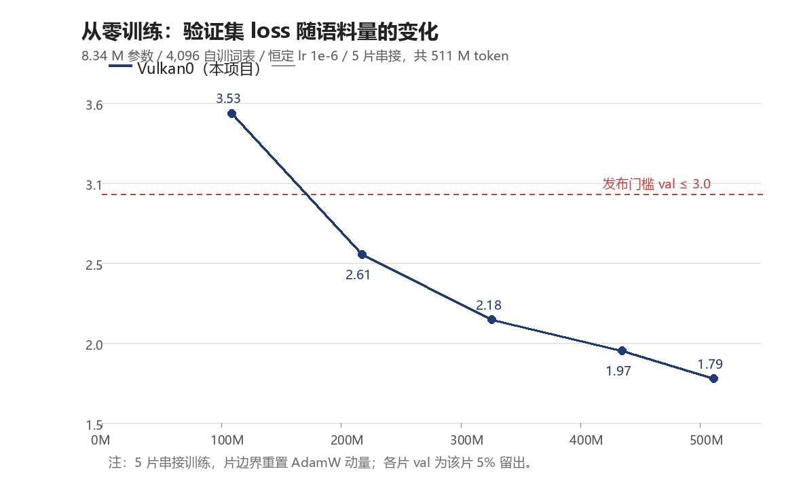

# vulkan-minitrain

**Train a small language model from scratch on Vulkan.**

## 1. What this is: Vulkan training + an 8.34 M parameter model

[Vulkan](https://www.vulkan.org/) is the cross-vendor GPU API — NVIDIA, AMD and Intel cards, on Windows,
Linux and Android. Deep-learning tooling has been locked to CUDA for years, so changing the GPU means
rewriting the training stack. **This project asks one question: can a language model be trained from random
initialization all the way to readable text on Vulkan alone?**

It can. Measured on a single RTX 4060 Ti after ~511 M training tokens (validation loss 1.79):



The training stack is not written from scratch — it is **llama.cpp, vendored** into `src/llama_train/`.
Upstream's Vulkan backend has been solid for inference, but its training path had two problems that either
slowed it down or silently broke it. Both fixes are **merged into the source tree** here:

| # | Change | Effect |
|---|---|---|
| 1 | `ggml.c`: `ggml_cont()` on the two `OUT_PROD` calls in the `MUL_MAT` backward path | Vulkan requires contiguous `OUT_PROD` inputs; without it 60.9% of the weight-gradient work **silently fell back to the CPU** |
| 2 | `out_prod.comp`: rewritten as a **shared-memory tiled GEMM** (64×64 tile, 256 threads, 4×4 register block per thread, padded shared arrays) | `OUT_PROD` GPU time 29.17 → **11.63 ms**, end-to-end **9,944 → 15,088 tok/s (1.52×)** |

Numerics match the CPU reference (differences are f32 accumulation order only), so this is not a
"it runs but you cannot trust it" demo.

### The model architecture used in the experiments

Deliberately small: TinyStories-style corpora do not need a large model, and a small one finishes a full run
on a single card in hours — which is what makes the "edit one shader → train → watch the loss" loop practical.

| | Value |
|---|---|
| Architecture | LLaMA-style decoder-only (RMSNorm + RoPE + SwiGLU) |
| Layers / width / heads | **6 / 288 / 6** (MHA, not GQA) |
| FFN width | 768 |
| Context | 1024 |
| Vocabulary | **4,096** — byte-level BPE trained on the corpus (§3) |
| Precision | all **f32** (llama.cpp has no f16/quantized backward path) |
| Parameters / size | **8.34 M / 31.9 MiB** |
| Config | [`configs/minitrain-6l288-4k.json`](configs/minitrain-6l288-4k.json) |

---

## 2. Prepare the dataset

```powershell
git clone <this repo> && cd vulkan-minitrain
python fetch-assets.py      # TinyStories text + optional wikitext-2 cross-domain corpus
```

Both mirrors (`hf-mirror.com` and `huggingface.co`) are **probed in parallel** and whichever answers first is
used (`--mirror` forces one). Downloads **resume** (HTTP Range, from `assets/<name>.part`), show a
**single-line progress bar**
with speed and ETA, and verify a pinned **sha256** for both TinyStories files (`--no-verify` to skip).
After a Ctrl-C or a dropped connection, just run the same command again to continue.

After that:

| File | What it is |
|---|---|
| `assets/TinyStories-train.txt` | full TinyStories training text (~**1.92 GB**) |
| `assets/TinyStories-valid.txt` | validation text |
| `assets/train-small.raw` | small sample corpus (the demo default, for a quick smoke test) |
| `assets/wikitext-2-raw/` | optional cross-domain corpus (shows the "it only knows stories" effect) |

> Tokenized with this project's 4,096-token vocabulary, 1.92 GB is about **522 M tokens**.
> Training slices the corpus into 1024-token windows; `--stride` sets the step (default 512 = half overlap,
> `--stride 1024` = no overlap and half the steps — the runs below use the latter).

---

## 3. Train the vocabulary, then slice the dataset

### 3.1 Train a 4K vocabulary on the corpus

No borrowed vocabulary — it is learned from the **full corpus** (byte-level BPE, GPT-2 style, standard
library only). This step reads the un-sliced file so the vocabulary sees the whole distribution:

```powershell
python tools\train-tokenizer.py --corpus assets\TinyStories-train.txt `
    --out-dir assets\vocab-4k --vocab-size 4096
```

About **9 minutes** on 1.92 GB, producing `assets/vocab-4k/vocab.json` + `merges.txt`
(4,096 tokens / 3,837 merges).

### 3.2 Build a randomly initialised model from the config

```powershell
python tools\make-model.py --config configs\minitrain-6l288-4k.json
```

This writes an **f32 GGUF** with the architecture from §1 and random weights (norms = 1.0, everything else
`N(0, 0.02)`), embedding the 4K vocabulary → `assets/minitrain-6l288-4k-random.gguf` (31.9 MiB).

Verify it really is random (optional but worth one run):

```powershell
python tools\check-random-init.py --model assets\minitrain-6l288-4k-random.gguf `
    --config configs\minitrain-6l288-4k.json
```

It checks three things: every `*_norm.weight` is exactly 1.0, all other tensors are `N(0, 0.02)`, and the same
seed rebuilds byte-identically. **Training-time tell**: the first loss should be near `ln(4096) = 8.32`
(seeing 1–2 means you loaded a trained model instead).

### 3.3 Why the dataset must be sliced

In memory the training dataset is **tokens + inputs + labels, three copies** (the `ggml_opt_dataset` layout),
so loading 1.92 GB of text at once needs roughly **19 GB of RAM** and gets killed by the OOM killer.

Note the order: the **vocabulary is trained on the full corpus** (§3.1, no slicing involved); slicing only
happens for the training step.

Slicing it into **five ~390 MB parts** brings the peak down to ~3.4 GB per part; training them in sequence
covers the whole corpus:

```powershell
python tools\make-slices.py --slice-mb 390
#  assets/TinyStories-train.txt  ->  assets/ts-full-1.raw … ts-full-5.raw (390/390/390/390/275 MB)
```

The splitter is plain Python and cross-platform; existing slices are skipped (`--force` rewrites them), and
`--corpus` / `--out-dir` / `--prefix` relocate the input and output.

---

## 4. Train from scratch: five chained slices, ~5 hours to readable stories

Slice 1 starts from the random model; every later slice **continues from the previous slice's output**
(`--load-latest`). The learning rate stays constant (`--decay off`) and a checkpoint is written every 30 minutes.

Five commands — run them **one after another** (each is self-contained, no shell variables; the first uses
`--config`, the rest chain with `--load-latest`):

```powershell
.\build\bin\Release\vulkan-minitrain.exe --config configs\minitrain-6l288-4k.json --file assets\ts-full-1.raw --device Vulkan0 --epochs 1 --lr 1e-6 --stride 1024 --decay off --save-every 30
.\build\bin\Release\vulkan-minitrain.exe --load-latest --file assets\ts-full-2.raw --device Vulkan0 --epochs 1 --lr 1e-6 --stride 1024 --decay off --save-every 30
.\build\bin\Release\vulkan-minitrain.exe --load-latest --file assets\ts-full-3.raw --device Vulkan0 --epochs 1 --lr 1e-6 --stride 1024 --decay off --save-every 30
.\build\bin\Release\vulkan-minitrain.exe --load-latest --file assets\ts-full-4.raw --device Vulkan0 --epochs 1 --lr 1e-6 --stride 1024 --decay off --save-every 30
.\build\bin\Release\vulkan-minitrain.exe --load-latest --file assets\ts-full-5.raw --device Vulkan0 --epochs 1 --lr 1e-6 --stride 1024 --decay off --save-every 30
```

> **Startup note**: the whole corpus is tokenized and turned into the sliding-window dataset first, and
> tokenization is **single-threaded at ~0.4 s per MB plus ~10 s of one-time setup** (a 390 MB slice ≈ 150 s with the GPU idle). The demo
> prints a `still tokenizing ...` heartbeat every 10 s and `training starts now` when real training begins.

Measured (RTX 4060 Ti / Vulkan0):

| Slice | Tokens | Train loss | **Validation loss** | acc (train/val) | Time |
|---|---|---|---|---|---|
| 1 | 108.6 M | 4.43886 | 3.53136 | 23.4% / 31.7% | 65 min |
| 2 | 108.7 M | 2.96357 | 2.60664 | 39.1% / 44.2% | 65 min |
| 3 | 108.6 M | 2.37786 | 2.17682 | 47.7% / 50.9% | 65 min |
| 4 | 108.6 M | 2.05165 | 1.97437 | 52.7% / 53.9% | 64 min |
| 5 | 76.6 M | 1.88005 | **1.78994** | 55.4% / 56.9% | 45 min |
| **Total** | **511.1 M** | — | — | — | **5.08 h (26,545 tok/s)** |

What the final model writes (temp 0.8 / seed 7):

> Once upon a time, there was a little girl named Lily. She loved playing in the park with her friends. One day,
> Lily's mom brought her a new video in the park. It was a special movie that made music.

> Tom and his dog went to the park. He saw that the dog was not nice. He looked at the slide and made a lot of
> noise. It was big and noisy. "Hey, ha, what are you doing?" Tom asked. He had an idea.

Generate your own:

```powershell
& $exe --load-latest --infer --prompt "Once upon a time" --n-predict 150 --temp 0.8
```

**Two things you must know**:

1. A slice boundary **resets the optimiser moments** (AdamW m/v), so the per-slice validation column is not a
   single continuous schedule — it is still a valid "how far from scratch did we get" measure;
2. Each slice's validation set is that slice's own 5% holdout, and slices are strictly train-then-test.

---

## Appendix: build and docs

```powershell
cmake -S . -B build -G "Visual Studio 18 2026" -A x64
cmake --build build --config Release --target vulkan-minitrain -- /p:BuildInParallel=false
```

The first build compiles thousands of Vulkan shader variants (~8–10 minutes); build gotchas and cross-platform
commands are in [`docs/RUN.md`](docs/RUN.md).

| Doc | Content |
|---|---|
| [`docs/2026-10-22-STAGE-SUMMARY.md`](docs/2026-10-22-STAGE-SUMMARY.md) | **stage summary**: how from-scratch training was made to work |
| [`docs/2026-10-19-PRETRAIN-REPORT.md`](docs/2026-10-19-PRETRAIN-REPORT.md) | full report: lr budget rules, kernel optimizations, precision facts |
| [`docs/RUN.md`](docs/RUN.md) | run manual: every CLI option, placement analysis, common errors |
| [`src/llama_train/LOCAL-CHANGES.md`](src/llama_train/LOCAL-CHANGES.md) | the two llama.cpp changes (per-file diff) |
| [`README.md`](README.md) | 中文版 |

License: [MIT](LICENSE) for this project's code. `src/llama_train/` is llama.cpp, also MIT, with its original
license kept at [`src/llama_train/LICENSE`](src/llama_train/LICENSE).
