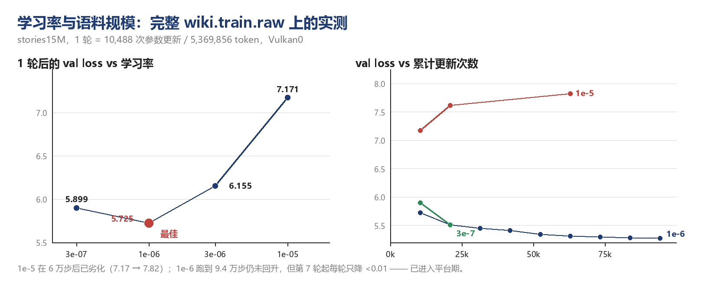

# 语料规模、吞吐与学习率（实测）

本文记录在**同一台机器**（RTX 4060 Ti + Ryzen 5 3600，Windows）上，用本演示程序对 stories15M 做的一系列标定：
语料从小到大时的耗时与吞吐、学习率该取多少、跑多少轮合适。

> 所有数字都是本机实测，原始日志列在第 10 节；模型结构见 [MODEL.md](MODEL.md)，补丁与性能背景见 [PLACEMENT-AND-PERF.md](PLACEMENT-AND-PERF.md)。

---

## 1. 一句话结论

1. **算力的真实单位是 token，不是 epoch**：三档语料下稳态吞吐都是 **~10,000 token/s**，即 **每 token ~0.1 ms**。语料变大只是"每轮步数变多"，速度不变。
2. **每轮耗时与语料规模严格线性**，另有 **~7 s 一次性 Vulkan 管线创建**（与数据量无关）。
3. **学习率必须随"累计更新次数"下降**：完整语料（1 轮 = 10,488 步）上最优是 **1e-6**，比上游默认的 `1e-5` 好 **1.45 个 nat**；而 6 万步时 1e-5 已经会**劣化**。
4. **轮数不是越多越好，但"几轮"取决于学习率**：小语料 20 轮会过拟合；完整语料上 lr 1e-5 时 **1 轮**就是 6 轮里最好的；lr 1e-6 时跑到 **9 轮** val 仍单调下降到 **5.273**（从未回升），但第 7 轮起每轮只降 <0.01 —— **平台期从第 7 轮开始**，性价比最优是 **6 轮 / 54 分钟**。

## 2. 指标口径：epoch / train / val / acc / Δval 是什么意思

后面所有表格都用这几列，先把口径定清楚 —— 这些数字全部来自 `src/minitrain.cpp` 里的三个调用：

```cpp
ggml_opt_result_ndata   (result_train, &nd_train);              // 本轮训练了多少 token
ggml_opt_result_loss    (result_train, &loss_train, &unc);      // 交叉熵（平均值 + 标准误）
ggml_opt_result_accuracy(result_train, &acc_train,  &unc);      // top-1 命中率
```

| 列 | 含义 | 单位 | 测量时点 | 用来判断什么 |
|---|---|---|---|---|
| **epoch** | 第几轮。**1 轮 = 把训练集完整过一遍 = 10,488 次参数更新**（完整语料，5,369,856 token） | 轮 | — | 训练进度；每轮墙钟 ≈ 8.9 分钟 |
| **train** | 训练集上的**交叉熵**，按 token 平均 | nat/token | **整轮滑动平均**（含训练刚开始、参数还很差的那几步） | 模型是否还在学 |
| **val** | 验证集上的**交叉熵**，按 token 平均 | nat/token | **轮末用最终权重算一次**（553 个样本 / 283,136 token） | **判断好坏、找谷底、决定轮数 —— 一切决策看它** |
| **acc** | 验证集 **top-1 准确率**（预测下一个 token 时最高分命中的比例） | % | 轮末 | 参考；**跨模型不可比** |
| **Δval** | 本轮 val − 上一轮 val（负值 = 变好） | nat | — | 收敛速度：−0.2 → −0.03 → −0.01 = 从"在学"进入"平台期" |

### 五个必须知道的口径细节

1. **train 与 val 的测量时点不同**。train 是整轮平均（开头"参数还很差"的步骤也计入分母），val 是轮末用最终权重测一次。所以**出现 `val < train` 是测量时点造成的假象**，不代表"越训越准"；反之亦然。**比较模型好坏只看 val。**
2. **loss 是 nats，不是概率**。换算成困惑度 `ppl = exp(loss)`：

   | loss | ppl | 直观含义 |
   |---|---|---|
   | 5.273（9 轮后 val） | **≈ 195** | 相当于在 195 个候选里均匀猜 |
   | 8.137（训练前） | ≈ 3,417 | 模型还没适应这份语料 |
   | 10.37 | 32,000 | **完全不会**：32000 词表上的均匀分布 = ln(32000) |

3. **acc 只有 0.24% 不代表坏了**。32000 词表下随机猜是 **0.003%**，所以 0.24% ≈ 随机基线的 **80 倍**。但 **acc 跨模型不可比**：stories260K 用 512 词表，随机基线就是 0.2%，同样写"11%"含义完全不同。（详见 [MODEL.md](MODEL.md) 第 4 节的对照表。）
4. **Δval 才是决策依据**。绝对值容易被误读（5.31 和 5.27 差 0.04 值不值得多花 27 分钟？），而 Δval 的趋势直接给答案：−0.218 → −0.059 → −0.032 → −0.021 → **−0.010 → −0.009**，一眼看出第 7 轮之后收益已经枯竭。
5. **进度条里的 `loss=X±Y`，±Y 是"均值的标准误"（sem）**，不是标准差、也不是置信区间。它由各 batch loss 的样本方差除以批数再开方得到（`ggml_opt_result_loss()` 里 `sqrt(var_sum/(nbatches-1))`），只反映**这一轮内 batch 之间的差异有多大**，**不反映**"这一轮比上一轮好多少"——后者只能看 Δval。epoch 汇总行（`[demo] epoch N:`）不打印 ±，只有进度条打印。

## 3. 吞吐标定：每 token 0.1 ms

| 语料 | 步数/轮 | epoch 0 | **稳态/轮** | 稳态 tok/s | 纯 CPU/轮 |
|---|---|---|---|---|---|
| 40 KB | 34 | 8.78 s | **1.73 s** | 10,062 | 20.65 s |
| 398 KB（11×） | 373 | 26.17 s | **19.1 s** | 10,004 | 217.8 s |
| **10.4 MB（完整 wiki.train.raw）** | **10,488** | 543.5 s | **534.5 s** | ~10,040 | —（外推 ~1.7 h） |

> 训练 token/轮：17,408 / 190,976 / 5,369,856；Vulkan 相对纯 CPU：11.9× / 11.4× / ~11.6×。

四个可直接拿去用的数字：

- **每 token ≈ 0.1 ms**（10,000 tok/s），与语料规模、轮数无关
- **首轮 = 稳态 + ~7.1 s**（8.78−1.73、26.17−19.1、543.5−536.4，三档一致）
- **CPU ≈ Vulkan × 11.5**（三档一致）
- 完整语料 **1 轮 = 9 分钟**（Vulkan），54 分钟 = 6 轮

> 54 分钟的连续运行里吞吐从 9,940 稳定到 10,049 tok/s，**没有热降频**。

## 4. 时间预算

| 目标 | Vulkan0 | 纯 CPU（按 11.5× 外推） |
|---|---|---|
| 完整语料 1 轮 | **9 分钟** | ~1.7 小时 |
| 完整语料 2 轮 | 18 分钟 | ~3.4 小时 |
| 完整语料 6 轮 | 54 分钟 | ~8.6 小时 |
| 398 KB 语料 12 轮 | 4 分钟 | ~43 分钟 |

这也是"打补丁后 Vulkan 能训练"的实际意义：**在这个规模上，GPU 把"跑一轮看看"从 1.7 小时变成 9 分钟。**

## 5. 学习率：1 轮扫描（完整语料，10,488 次更新）



| lr | train loss（轮均值） | **val loss（轮末）** | acc |
|---|---|---|---|
| 3e-7 | 6.278 | 5.899 | 0.15% |
| **1e-6** | **6.007** | **5.725** ← 最佳 | 0.16% |
| 3e-6 | 6.280 | 6.155 | 0.14% |
| 1e-5（上游默认） | 7.210 | 7.171 | 0.10% |

- **最优在 1e-6 附近**：往上 3e-6 差 0.43，往下 3e-7 差 0.17
- 曲线**不对称**：往小走劣化慢，往大走劣化快 → 真正的悬崖在 1e-5 一侧
- **1e-5（上游 `llama-finetune` 的默认值）在这个模型/语料上偏差 1.45 个 nat**

> ⚠️ 判断"哪个学习率更好"要看 **val（轮末、用最终权重算）**，不要看 train。train 是**整轮均值**，包含训练刚开始、参数还很差的步；学习率越小前期越"慢热"，均值被系统性拖高。

## 6. 为什么不能只有一个固定学习率

2 轮（20,976 次更新）对照：

| lr | ep0 val | ep1 val | 结论 |
|---|---|---|---|
| 1e-6 | 5.725 | **5.507** | 起步快 |
| 3e-7 | 5.899 | **5.512** | 第 2 轮追平（差 0.005） |

1 轮时 1e-6 领先 0.174，2 轮时差距缩到 0.005 —— **走小步的 3e-7 会追上来**。

再看 **1e-6 的长跑（9 轮 = 94,392 次更新，80.6 分钟）**：

| epoch | train loss | val loss | acc | 每轮 val 变化 |
|---|---|---|---|---|
| 0 | 6.007 | 5.725 | 0.16% | — |
| 1 | 5.199 | 5.507 | 0.20% | −0.218 |
| 2 | 4.885 | 5.448 | 0.22% | −0.059 |
| 3 | 4.692 | 5.412 | 0.22% | −0.036 |
| 4 | 4.539 | 5.344 | 0.23% | −0.069 |
| 5 | 4.396 | 5.312 | 0.23% | −0.032 |
| 6 | 4.272 | 5.292 | 0.24% | −0.021 |
| 7 | 4.183 | 5.281 | 0.24% | −0.010 |
| 8 | **4.111** | **5.273** | **0.24%** | −0.009 |

- **9 轮内 val 一直在降，从未回升** → 严格意义上**没有出现拐点**
- 但降幅已经衰减到 **< 0.01/轮**（−0.218 → −0.032 → −0.021 → −0.010 → −0.009）→ **实际已进入平台期**
- **train-val 差距持续拉大**（0.28 → 0.92 → 1.16），过拟合在稳定积累，只是还没反超 val 的改善
- 按最后三轮的等比衰减外推，val 的渐近值约 **5.25–5.26**，剩下的全部改善不到 0.02

> **所以"谷底"更准确的说法是"平台期从第 7 轮开始"**：第 7 轮之后每多跑一轮只值 0.01 nat，而代价是 9 分钟。
> 性价比最优仍是 **6 轮 / 54 分钟（val 5.312）**；跑到 9 轮（80.6 分钟）只多降 **0.039**。

再看 1e-5 的长跑（同样 6 轮 = 62,928 次更新）：

| epoch | 0 | 1 | 2 | 3 | 4 | 5 |
|---|---|---|---|---|---|---|
| train | 7.210 | 7.275 | 7.568 | 7.645 | 7.606 | **7.683** |
| val | 7.171 | 7.619 | 7.633 | 8.004 | 8.036 | **7.819** |
| acc | 0.10% | 0.12% | 0.13% | 0.13% | 0.14% | 0.14% |

loss 一路**变差**，而 acc 还在**变好** —— 这是"模型越来越自信、但校准变差"的典型形态（没有 weight decay、没有 lr 衰减时长跑就是这个结果）。

**结论：最优学习率随累计更新次数下降**。1e-5 在几百步时合适，在 1 万步时偏大，在 6 万步时明显过大。这正是 lr 衰减存在的理由：

```cpp
// common/common.cpp
float lr_opt::get_lr(float epoch) const {
    float r = lr_min <= 0 ? lr0 :                   // ← 默认 lr_min = -1，走这里
        epoch >= decay_epochs ? lr_min :
        lr0 * std::pow(0.5f, epoch * scale_epoch);
```

默认 `lr_min = -1` → **永远返回 `lr0`，没有衰减**；默认 `wd = 0`（无权重衰减）。上游 CLI 支持 `-wd/--weight-decay`、`--lr-min`、`--decay-epochs`，但**本演示只透传了 `-lr`**。

## 7. 轮数：取决于学习率（1e-5 一轮即最优，1e-6 九轮才进平台期）

两种语料、两种学习率的命运：

| 语料 | lr | 轮数 | 更新次数 | train | val | 现象 |
|---|---|---|---|---|---|---|
| 40 KB | 1e-5 | 20 | 680 | 8.14 → **5.01** | 8.29 → 6.79（第 4 轮见底）→ 7.00 | **过拟合**：train 继续降，val 见底回升 |
| 10.4 MB | 1e-5 | 6 | 62,928 | 7.21 → 7.68 | 7.17 → 7.82 | **不过拟合**，是 lr 过大导致的漂移 |
| **10.4 MB** | **1e-6** | **9** | 94,392 | 6.01 → **4.11** | 5.73 → **5.27** | **未回升但已平台化**（第 7 轮起 <0.01/轮），缓慢过拟合（差距 0.28 → 1.16） |

- 小语料（34 步/轮）第 5 轮起基本在"背训练集"；
- 完整语料 + lr 1e-5（10,488 步/轮）根本背不下来，问题是学习率而非轮数；
- 完整语料 + lr 1e-6 是**健康的长跑**：val 单调下降，只是过拟合在慢慢积累。

**实践建议**：先按"**1 轮 = 9 分钟**"跑一次看 val，再决定要不要加轮。用 `1e-6` 时 **9 轮（80 分钟）都没有出现劣化**，但第 7 轮之后收益已经很小（<0.01/轮），**6 轮是性价比最优**；用 `1e-5` 时第 1 轮之后就开始变差。

## 8. 一个工具级 bug（已修，值得记下）

早期用 `--lr 3e-7` 会**直接崩溃**：

```
[demo] train  : ... lr 0 ...                                    ← 3e-7 变成 0
ggml-opt.cpp:789: GGML_ASSERT(opt_pars.adamw.alpha > 0.0f) failed
exit = -1073740791 (0xC0000409, fail-fast)
```

根因是演示程序用 `std::to_string(float)` 拼参数 —— 它**只保留 6 位小数**，`3e-7` 被格式化成 `"0.000000"`，上游解析成 0，触发断言。

修法（`src/minitrain.cpp`）：

1. 学习率与 `--val-split` 改用 `snprintf("%.10g")` 格式化（`3e-7 → "3e-07"`）
2. 加前置校验：`--lr <= 0` 或 `--epochs <= 0` 直接报错退出

> 顺带说一句：**上游那个 `GGML_ASSERT` 帮了大忙** —— 它让"学习率为 0"这种静默错误立刻崩溃，而不是假装训练了 9 分钟。

## 9. 复现

> 完整语料的逐步操作（准备语料 / 估时 / 后台跑法 / 注意事项）见 [RUN.md](RUN.md) 第 7 节；下面是速查命令。

```powershell
cd vulkan-minitrain
$exe = ".\build\bin\Release\vulkan-minitrain.exe"
$full = "assets\wikitext-2-raw\wiki.train.raw"   # 10.4 MB，2,827,025 token（fetch-assets.py 准备）

# 学习率扫描（各 9 分钟）
& $exe --file $full --epochs 1 --lr 1e-6      # 最佳：val 5.725
& $exe --file $full --epochs 1 --lr 3e-6
& $exe --file $full --epochs 1 --lr 3e-7
& $exe --file $full --epochs 1 --lr 1e-5

# 2 轮对照（各 18 分钟）
& $exe --file $full --epochs 2 --lr 1e-6      # val 5.507
& $exe --file $full --epochs 2 --lr 3e-7      # val 5.512（追平）

# 长跑：1e-6 跑 6 轮 = 54 分钟 -> val 5.312（性价比最优）
& $exe --file $full --epochs 6 --lr 1e-6

# 再长一点：9 轮 = 80.6 分钟 -> val 5.273（第 7 轮起进入平台期）
& $exe --file $full --epochs 9 --lr 1e-6

# 小语料（1.7 s/轮，适合快速试参数）
& $exe --file assets\tinystories-train-40mb.raw --epochs 2 --lr 1e-5

# 纯 CPU 对照（约 11.5× 慢）
& $exe --file $full --epochs 1 --lr 1e-6 --device CPU
```

> 一次只跑一个：两个训练同时跑会互相抢 GPU，**两边读数都会失真**。

## 10. 原始日志

全部在 `docs/` 下（PowerShell `Tee-Object` 写的，编码是 UTF-16，解析时注意）：

| 日志 | 内容 |
|---|---|
| `bench20-vulkan.log` / `bench20-cpu.log` | 40 KB 语料，20 轮，`lr 1e-5`，Vulkan / CPU |
| `bigcorpus-vulkan.log` / `bigcorpus-vulkan12.log` / `bigcorpus-cpu.log` | 398 KB 语料，6 轮 / 12 轮 / CPU 1 轮 |
| `fullcorpus-vulkan.log` | 完整语料 1 轮，`lr 1e-5` |
| `fullcorpus-vulkan-6ep.log` | 完整语料 6 轮，`lr 1e-5`（含 62,928 条进度行，可提取轮内轨迹） |
| `fullcorpus-vulkan-2ep-lr1e-6.log` | 完整语料 2 轮，`lr 1e-6` |
| `fullcorpus-vulkan-6ep-lr1e-6.log` | 完整语料 6 轮，`lr 1e-6`（val 5.312） |
| `fullcorpus-vulkan-9ep-lr1e-6.log` | 完整语料 **9 轮，`lr 1e-6`（当前最优：val 5.273，80.6 分钟）** |
| `fullcorpus-vulkan-1ep-lr3e-6.log` / `-1ep-lr3e-7.log` / `-2ep-lr3e-7.log` | 学习率扫描 |

图由 `docs/make-charts.py` 生成（Pillow 绘制，无 matplotlib 依赖）。

## 11. 相关文档

| 文档 | 内容 |
|---|---|
| [MODEL.md](MODEL.md) | 模型档案：结构 / 参数量 / TinyStories 背景 / 注意点 |
| [RUN.md](RUN.md) | 手动运行说明、跨平台命令序列、四个构建坑 |
| [APPLY-PATCH.md](APPLY-PATCH.md) | 打 `ggml_cont` 补丁（Vulkan 快 1.86×） |
| [PLACEMENT-AND-PERF.md](PLACEMENT-AND-PERF.md) | 落点与性能图文说明 |
